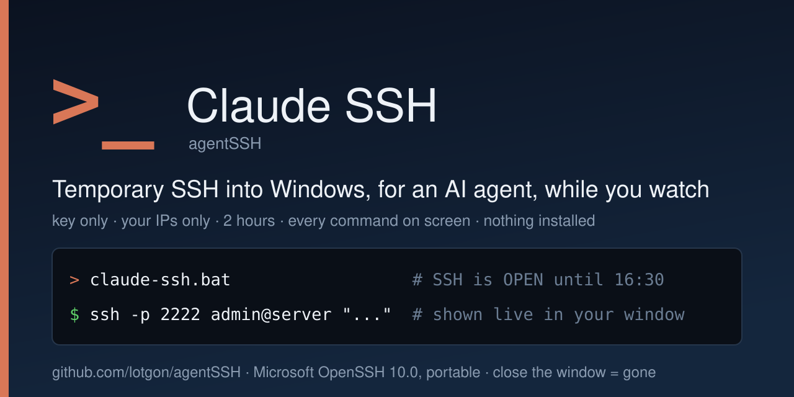
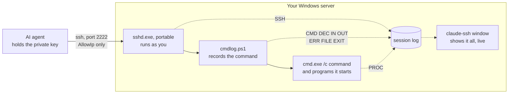
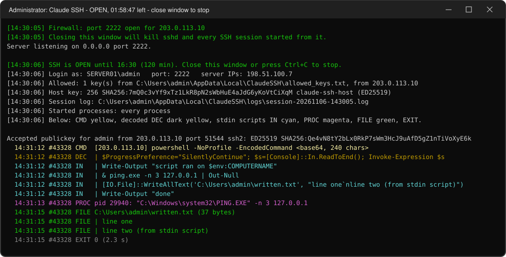

# Claude SSH: temporary, watched SSH access to a Windows server


-brightgreen)

[](https://github.com/lotgon/agentSSH/releases/latest)

<p align="center">
  
</p>

> **Let an AI agent such as Claude Code (or a colleague) work on your Windows server over SSH.
> Access lasts two hours, needs their key, works only from their IP address, and every command,
> script and started program shows up in a window on your screen. Close the window, and the
> access, the sessions and everything they started are gone.**

**The whole tool in one line:** run `claude-ssh.bat` on the server, then give the agent the login
line it prints.

```bat
:: SERVER: open SSH for 2 hours (asks for administrator rights)
claude-ssh.bat
:: WORKSTATION (the agent): log in with the key you allowed
ssh -i ~/.ssh/claude-access_ed25519 -p 2222 admin@198.51.100.7 "hostname"
```

**Why people use it**
- 📦 **Nothing to install.** Microsoft's portable OpenSSH runs straight from the folder: no
  Windows feature, no service, no reboot. The system sshd on port 22, if there is one, is not touched.
- ⏱️ **Access ends by itself.** 2 hours by default (up to 12). When time is up, the window closes
  everything. The key also expires on its own, as a second guard.
- 🔑 **Key only, from your addresses only.** This sshd has no password login at all. The firewall
  *and* sshd both check the client's address.
- 👀 **You see what really runs.** Not only the command line, but also decoded
  `-EncodedCommand`, the scripts piped in through stdin, every program they start and the
  content of the files they write. [What the window shows ↓](#what-you-see-in-the-window)
- 🧯 **One kill switch.** Close the window or press Ctrl+C, and Windows kills sshd, every session
  and every command started from it.
- 🗄️ **Private by default.** Keys, settings and logs live in `%LOCALAPPDATA%\ClaudeSSH`, readable
  only by you, SYSTEM and Administrators. Never next to the tool, never in git.
- 📜 **A log to go through afterwards.** One file per session, a date and time on every line: who
  logged in and with which key, failed attempts, every command, the scripts sent to it, what it
  printed back, the files it wrote and how it ended. [The session log ↓](#the-session-log)
- 🧁 **Set up once, copy everywhere.** `claude-ssh.bat -Bake` puts your key and addresses into a
  zip of the tool. Unzip it on any server and start it. [Baking ↓](#many-servers-bake-your-settings-in-once)

> **Status:** young (v0.2). Tested on Windows 11 over loopback, without administrator rights. Not yet
> tested on Windows Server, with the firewall rule, or across a real network. Try it on a test
> server first. See [Limitations](#limitations).

---

## What it does

An AI coding agent (for example [Claude Code](https://claude.com/claude-code)) works through a
terminal: it can manage a remote machine if it can `ssh` into it. Windows servers usually have no
SSH, and installing a permanent SSH server just so an agent can fix one thing is more access than
you want to give.

Claude SSH opens SSH **for one session**, on your terms:

1. You run `claude-ssh.bat` on the server. It starts Microsoft's OpenSSH server in its own console
   window, under your Windows account, on port 2222.
2. Only the public keys you listed can log in, only from the addresses you listed, and only until
   the deadline.
3. Every command the agent sends goes through a small logger (`cmdlog.ps1`) and is then run by
   `cmd.exe`, exactly as it would be without the logger. The window prints what the logger records
   and every process the command starts, in color, as it happens. The session log keeps all of
   it, plus every login and what each command printed.
4. When you close the window, press Ctrl+C or the time runs out, everything stops: sshd, sessions,
   commands, the firewall rule.



## Problems it solves

- "I want Claude Code to set up or fix something on a Windows server, but I don't want to install
  a permanent SSH server or hand out an RDP password."
- "The agent runs `powershell -EncodedCommand ...` and pipes scripts through stdin. I can't see what
  actually runs." → decoded commands, full stdin scripts, every started process.
- "I want the access to end on its own, even if I forget about it." → the deadline, plus a key
  that expires.
- "I need a record of what was done on the server." → the session log: who logged in and when,
  every command, its script and its output, written files, exit codes.
- "If something looks wrong, I want to stop everything at once." → close the window.

## Who should use it, and who shouldn't

**Good fit**
- You administer the server and want to let an agent or a colleague do a task in a shell while
  you watch: installing, configuring, diagnosing, migrating.
- One-off sessions: open for a couple of hours, close, done.
- Servers where you can't or don't want to install the OpenSSH Server feature.

**Look elsewhere if**
- You need **permanent** remote access → install the OpenSSH Server feature, or use RDP or
  PowerShell Remoting.
- You want to **approve each command** before it runs. Claude SSH *shows* commands, it does not
  ask: a command runs as soon as it arrives. If you see something you don't like, close the window.
- Several people need to log in **as different users**. sshd runs as you, so it can only log
  people in as you.
- Nobody will be at the server. Each session needs someone to start the window and confirm the
  administrator prompt (UAC).

## How it compares

| | **Claude SSH** | OpenSSH Server (Windows feature) | RDP | PowerShell Remoting |
|---|---|---|---|---|
| Install on the server | **nothing, unzip and run** | optional feature + service | built in, must be enabled | built in, must be enabled |
| How long access lasts | **while the window is open (2 h by default, 12 h max)** | until you turn it off | until you turn it off | until you turn it off |
| Login | **listed keys only, no passwords** | passwords and keys | password | Windows credentials |
| Who can connect | **AllowIp, checked by the firewall and by sshd** | you configure | you configure | you configure |
| What you see | **every command, stdin script, started program and written file, live** | connections in the event log | the desktop, if you watch it | nothing, unless transcription is set up |
| Stop everything | **close the window** | stop the service, end the sessions | sign the session out | end the sessions |
| An AI agent can drive it from a terminal | **yes, plain `ssh`** | yes, plain `ssh` | no (graphical) | needs PowerShell and Windows credentials |

Rule of thumb: use **Claude SSH** to let an agent into a Windows server **for one task, under
your eyes**. Install the **OpenSSH Server feature** when SSH should stay on. Claude SSH runs the
same Microsoft OpenSSH, only portable, for one session and with its own settings.

## Why it's safe

Three locks: **key**, **address** and **time**. The address and time locks are each enforced twice.

| Layer | What it does |
|---|---|
| Key only | sshd has no password or keyboard-interactive login. Only the public keys in `allowed_keys.txt` work. The private key never leaves the workstation. |
| Your addresses, twice | A Windows Firewall rule opens the port only for `AllowIp`. Each key also gets `from="<AllowIp>"`, so sshd refuses it from any other address even if the firewall lets the connection through. |
| Time, twice | The window stops everything at the deadline. Each key also gets `expiry-time`, so it stops working even if the window somehow kept running. |
| Your account only | sshd runs as you, so nobody can log in as anyone else. Port, agent and X11 forwarding and tunnels are off. |
| One kill switch | The window and everything it starts are in a Windows Job Object with kill-on-close. If the window is closed or its process is killed, Windows kills sshd, the sessions and the commands. |
| Private data folder | `%LOCALAPPDATA%\ClaudeSSH` has inheritance turned off: only you, SYSTEM and Administrators can read it. |
| Tamper warning | The window runs with administrator rights, so whoever can change the tool's files could run code as you. If Everyone, Users, Authenticated Users, INTERACTIVE or Guests can change them, the window warns in red. |
| Signed binaries | `OpenSSH-Win64` is Microsoft's Win32-OpenSSH 10.0p2. All its files carry Microsoft's signature, and the repository stores them byte for byte. |

**Know what you are giving:** commands run as your account, with the rights of the window. The
window is elevated, so assume the agent has your **administrator** rights until the window closes.

---

## Quick start

You need: a Windows server you can sign in to (RDP or console), and the workstation where the
agent runs.

**1. On the workstation: make a key for the agent** (once).
```bash
ssh-keygen -t ed25519 -f "$HOME/.ssh/claude-access_ed25519" -C claude-access
```
You will need the **public** half, `~/.ssh/claude-access_ed25519.pub`, and the address the server
will see the workstation come from (the public IP for internet access, or the LAN/VPN address).

**2. On the server: download and unzip into your profile.** In PowerShell:
```powershell
[Net.ServicePointManager]::SecurityProtocol = [Net.ServicePointManager]::SecurityProtocol -bor [Net.SecurityProtocolType]::Tls12
$ProgressPreference = 'SilentlyContinue'
$d = [Environment]::GetFolderPath('Desktop')
Invoke-WebRequest https://github.com/lotgon/agentSSH/releases/latest/download/claude-ssh.zip -OutFile "$d\claude-ssh.zip" -UseBasicParsing
Expand-Archive "$d\claude-ssh.zip" $d -Force
& "$d\claude-ssh\claude-ssh.bat"
```
Or download [`claude-ssh.zip`](https://github.com/lotgon/agentSSH/releases/latest/download/claude-ssh.zip)
with a browser, open the file's **Properties** and tick **Unblock**, then unzip it to your Desktop.

Keep the folder in **your profile** (Desktop, Documents), not in `C:\` or `C:\Tools`. See the
tamper warning above.

**3. First start: fill in two files.** The first start creates `%LOCALAPPDATA%\ClaudeSSH`, opens
it in Explorer and stops. Fill in:
- `allowed_keys.txt`: paste the public key from step 1 (one line, `ssh-ed25519 AAAA... claude-access`);
- `claude-ssh.config`: remove the `#` before `AllowIp` and put the workstation's address there.

A [baked copy](#many-servers-bake-your-settings-in-once) brings both files, so this step is not
needed with it.

**4. Start `claude-ssh.bat` again.** Confirm the administrator prompt (needed for the firewall
rule). The window shows:
```text
[14:30:06] SSH is OPEN until 16:30 (120 min). Close this window or press Ctrl+C to stop.
[14:30:06] Login as: SERVER01\admin   port: 2222   server IPs: 198.51.100.7
[14:30:06] Host key: 256 SHA256:7mQ0c3vYf9xTz1LkR8pN2sWbHuE4aJdG6yKoVtCiXqM claude-ssh-host (ED25519)
```

**5. Tell the agent how to connect.** For example, to Claude Code:
```text
SSH into my Windows server: host 198.51.100.7, port 2222, user admin,
key ~/.ssh/claude-access_ed25519. Host key fingerprint:
SHA256:7mQ0c3vYf9xTz1LkR8pN2sWbHuE4aJdG6yKoVtCiXqM. Do not connect if it differs.
Commands run in cmd.exe; use powershell -NoProfile -Command "..." for PowerShell.
Access ends at 16:30.
```
On the first connection, ssh asks to confirm the server's key. It must match the `Host key` line in
the window (an agent can check it first with `ssh-keyscan -p 2222 198.51.100.7 | ssh-keygen -lf -`).
The key is created once and kept, so the fingerprint stays the same from session to session.

The user name is the part of `Login as:` after the backslash (`admin`). This was tested with a
local account; domain accounts were not tested yet.

To stop: close the window, or press Ctrl+C in it.

## Many servers: bake your settings in once

Filling in two files on every server gets old. Set up one server, then bake its settings into a
copy of the tool and carry that copy everywhere. The settings always live in
**`%LOCALAPPDATA%\ClaudeSSH`**: that is where a bake takes them from, and where a baked copy puts
them.

```text
 1. Bake                       2. Install                     3. Update
 a set-up server               any other server               any server that has it
 %LOCALAPPDATA%\ClaudeSSH      unzip, start claude-ssh.bat    unzip the new release over
   -> claude-ssh.bat -Bake       baked\ -> %LOCALAPPDATA%\     the folder, then -Bake again:
   -> claude-ssh-baked.zip                  ClaudeSSH          a baked copy of the new
                                 SSH opens                     version for the other servers
```

**1. Bake.** On a server where the tool is set up and works:
```bat
claude-ssh.bat -Bake
```
It takes the key and settings from `%LOCALAPPDATA%\ClaudeSSH` and the code from its own folder, and
writes `claude-ssh-baked.zip` to the Desktop: the tool plus `baked\allowed_keys.txt` and
`baked\claude-ssh.config`. It prints where everything came from. On a machine with nothing set up,
give the key and addresses directly:
```bat
claude-ssh.bat -Bake -PublicKey %USERPROFILE%\.ssh\claude-access_ed25519.pub -AllowIp 203.0.113.10
```

**2. Install.** Copy the zip to any server, unzip it into your profile, start
`claude-ssh\claude-ssh.bat`. The first start copies `baked\` to `%LOCALAPPDATA%\ClaudeSSH` and
opens SSH: nothing to fill in.

**3. Update.** When a new version comes out, on any server that already has the tool: unzip the
release over the old folder (your settings stay in `%LOCALAPPDATA%\ClaudeSSH`) and run
`claude-ssh.bat -Bake` there. The new zip has the new code and the same settings; install it on the
other servers as in step 2. Or unzip the plain release over the folder on every server: that keeps
the settings too.

Good to know:
- **The host key is never baked.** Every server makes its own on its first start, so the agent
  confirms each server once, as usual.
- **Change of key or address:** change it on one server (or pass `-PublicKey`, `-AllowIp`), bake,
  and install the new copy over the old folders. Their next start copies the changed files once
  and keeps the old ones as `*.bak`. A bake with the same settings changes nothing.
- **Edits by hand** on one server (say, a longer `Duration`) stay until you bring a bake with
  different settings, and go into the bakes you make on that server.
- **Only public keys** are baked: `-Bake` refuses a file that holds a private key.
- The zip holds your public key and your addresses. It is not secret like a private key, but
  share it like a config file, not publicly.

## What you see in the window

<p align="center">
  
</p>
<p align="center"><sub>From a test run. Names, addresses and paths are changed.</sub></p>

- Everything appears as `time #id TAG text`. The `#id` is the same for all lines of one command,
  so parallel commands can be told apart. Lines of sshd itself have no `#id`.
- `SSH` lines come from sshd. The window shows logins (white), failed attempts (red) and anything
  unusual. Its routine lines (connection opened, session started and closed) go to the log only.

| Tag | Color | What it shows |
|---|---|---|
| `SSH` | white, red on failure | sshd: logins with the key fingerprint, failed attempts |
| `CMD` | yellow | the command line and the address it came from |
| `DEC` | dark yellow | the decoded text of `powershell -EncodedCommand` |
| `IN` | cyan | text sent on stdin: the scripts run through `[Console]::In.ReadToEnd()` |
| `PROC` | magenta | every process the command started, with its full command line (indent = nesting) |
| `FILE` | green | files the command wrote (`WriteAllBytes`, `WriteAllText`, `WriteAllLines`, `Set-Content`, `Out-File`) and their content. A file uploaded in base64 chunks is shown decoded. |
| `EXIT` | gray, red on error | exit code and run time |
| `NOTE` | gray | anything else, for example an interactive (`ssh -t`) session |
| `OUT`, `ERR` | not shown | what the command printed: in the [session log](#the-session-log) only |

**In the window**, a block shows its first 40 lines, long lines are cut at 400 characters and long
base64 becomes `<base64, N chars>`. The session log has all of it.

**Started processes:** with administrator rights the window subscribes to every process start.
Without them (`-NoFirewall`), it checks once a second and can miss processes that live less than a
second.

## The session log

One file per session: `%LOCALAPPDATA%\ClaudeSSH\logs\session-<yyyyMMdd-HHmmss>.log`, a plain text
file (UTF-8). It is written while the session runs, so it survives even if the window is killed, and it is
kept after the session ends.

It has everything the window shows, nothing cut short and a date on every line, plus:
- `SSH`: all of sshd's messages: connections, logins with the key fingerprint, failed attempts,
  disconnects;
- `OUT` and `ERR`: what each command printed (stdout and stderr), exactly what the agent got back;
- `NOTE`: when SSH opened and closed, and commands that were still running when it closed.

An excerpt (from a test run, shortened; names and addresses changed):

```text
2026-11-06 14:31:11 #0 SSH  Accepted publickey for admin from 203.0.113.10 port 51544 ssh2: ED25519 SHA256:Qe4vN8tY...
2026-11-06 14:31:12 #43328 CMD  [203.0.113.10] powershell -NoProfile -EncodedCommand JABQAHIAbwBnAHIAZQBz...
2026-11-06 14:31:12 #43328 DEC  | $ProgressPreference="SilentlyContinue"; $s=[Console]::In.ReadToEnd(); Invoke-Expression $s
2026-11-06 14:31:12 #43328 IN   | Write-Output "script ran on $env:COMPUTERNAME"
2026-11-06 14:31:12 #43328 IN   | & ping.exe -n 3 127.0.0.1 | Out-Null
2026-11-06 14:31:12 #43328 IN   | Write-Output "done"
2026-11-06 14:31:13 #43328 PROC pid 29940: "C:\Windows\system32\PING.EXE" -n 3 127.0.0.1
2026-11-06 14:31:15 #43328 OUT  | script ran on SERVER01
2026-11-06 14:31:15 #43328 OUT  | done
2026-11-06 14:31:15 #43328 EXIT 0 (2.3 s)
2026-11-06 14:32:40 #0 SSH  Failed publickey for admin from 203.0.113.10 port 51602 ssh2: ED25519 SHA256:Zk3pW9xQ...
```

The top of every file explains the tags. To go through all sessions at once, in PowerShell:

```powershell
$logs = "$env:LOCALAPPDATA\ClaudeSSH\logs\session-*.log"
# every command, with date, time and address
Select-String -Path $logs -Pattern '^\S+ \S+ #\d+ CMD ' | ForEach-Object Line
# logins and failed attempts
Select-String -Path $logs -Pattern ' SSH  (Accepted publickey|Failed|Invalid user)' | ForEach-Object Line
# everything about one command, by its #id
Select-String -Path $logs -Pattern ' #43328 ' | ForEach-Object Line
```

**Limits:** per command, up to 1 MB of stdin, 1 MB of stdout, 1 MB of stderr and 256 KB per
written file are kept; for the rest the log says how many bytes there were. Binary data is noted
with its size only. Output that is not valid UTF-8 is read in the console code page. In an
interactive session (`ssh -t`) keystrokes and output are not logged; the programs started in it
are.

**Secrets:** the log contains what the agent sent and what it got back: passwords in config files
and in command output included. The folder is private, but keep that in mind before you send a log
to anyone. Old logs are never deleted by the tool; delete them yourself when you no longer need
them.

## Where things live, and who can read them

| What | Where | Who has access |
|---|---|---|
| Scripts and OpenSSH | the folder you unzipped | whoever can write to that folder, so keep it in your profile |
| `claude-ssh.config`, `allowed_keys.txt` | `%LOCALAPPDATA%\ClaudeSSH` | you, SYSTEM, Administrators |
| Baked settings (a baked copy only) | `baked\` in the tool folder, copied to `%LOCALAPPDATA%\ClaudeSSH` on start | like the scripts: keep the folder in your profile |
| Server host key | `%LOCALAPPDATA%\ClaudeSSH\hostkey` | you, SYSTEM, Administrators (sshd requires this) |
| Session logs | `%LOCALAPPDATA%\ClaudeSSH\logs` | you, SYSTEM, Administrators |
| `authorized_keys`, `sshd_config` of the current session | `%LOCALAPPDATA%\ClaudeSSH\session` | created at start, deleted at stop |
| The agent's private key | the workstation only | never reaches the server |

At every start the tool resets the permissions of `%LOCALAPPDATA%\ClaudeSSH` to: you, SYSTEM and
Administrators only.

## Settings

**`claude-ssh.config`** (in `%LOCALAPPDATA%\ClaudeSSH`): where from, which port, how long.
```ini
# Addresses allowed to connect: one per line or comma separated; subnets OK (10.8.0.0/24)
AllowIp = 203.0.113.10
AllowIp = 198.51.100.20
# Default session length: 2h, 90m, 1h30m; 12h at most
Duration = 2h
# Not 22, so it never clashes with a system sshd
Port = 2222
```

**`allowed_keys.txt`**: who. Public keys, one per line (`ssh-ed25519`, `ssh-rsa`, `ecdsa-*`,
`sk-*`). Usually just the agent's key. Lines starting with `#` are ignored.

**Parameters** override the config for one run:

| Parameter | Default | What it does |
|---|---|---|
| `-Duration 4h` | `Duration` from the config, else `2h` | session length: `90m`, `1h30m`, `3` (hours); 1 minute to 12 hours |
| `-Port 2200` | `Port` from the config, else `2222` | TCP port for sshd |
| `-AllowIp 203.0.113.10,10.8.0.0/24` | `AllowIp` from the config | allowed addresses |
| `-ListenAddress 10.0.0.5` | `0.0.0.0` | the server address sshd listens on |
| `-DataDir D:\ClaudeSSH` | `%LOCALAPPDATA%\ClaudeSSH` | where settings, keys and logs live |
| `-NoFirewall` | off | no firewall rule and no administrator prompt; processes are checked once a second |
| `-Bake` | off | no SSH: write a [baked copy](#many-servers-bake-your-settings-in-once) with the key and settings in it |
| `-PublicKey a.pub,b.pub` | none | with `-Bake`: public keys to add to the ones already set up |
| `-BakeTo D:\out.zip` | `Desktop\claude-ssh-baked.zip` | with `-Bake`: where to write the zip |

Example: `claude-ssh.bat -Duration 4h`. With `-Bake`, `-AllowIp`, `-Port` and `-Duration` go into
the baked copy.

## Upgrading from v0.1

Unzip the new version **over the old folder** and start it. v0.1 kept `allowed_keys.txt`,
`claude-ssh.config`, `hostkey\` and `last-session-commands-*.log` next to the script. The first
start of v0.2 moves them to `%LOCALAPPDATA%\ClaudeSSH`. The host key moves with them, so the
fingerprint does not change and the agent does not need to confirm the server again.

To go back to v0.1 after that, copy those files back next to the script. Otherwise v0.1 creates a
new host key with a new fingerprint.

## Limitations

- **It watches, it does not approve.** Commands run as soon as they arrive. To stop them, close
  the window.
- Commands run as **your account with the window's (administrator) rights**. Only your account can
  log in.
- Keystrokes and output of an interactive session (`ssh -t`) are not logged. The programs started
  in it are.
- **About 2 MB of stdin per command.** Scripts and data up to 2 MB went through in about a second;
  3.4 MB hung. A command that reads and prints megabytes at the same time (a filter such as
  `findstr` over a big file) can hang too. Microsoft's sshd behaves the same without this tool.
  Send big files in chunks.
- `FILE` catches only files written by the methods listed above with a path written in quotes.
  Files changed in other ways (`Copy-Item`, `robocopy`, other programs) show up only as the
  command or process that changed them.
- `scp` and `sftp` were not tested and are not expected to work: every session goes through the
  command logger. Agents can send files through commands (for example base64 + `WriteAllBytes`),
  and the window then shows the decoded file.
- Without administrator rights (`-NoFirewall`), very short processes may be missed.
- If the window is closed with the ✕ button, the firewall rule `Claude-SSH-session` may stay
  behind. That is harmless (nothing listens on the port), and the next start removes it.
- The server must be Windows with Windows PowerShell 5.1 (included in Windows 10 and Windows
  Server 2016 and later). Tested on Windows 11 only so far.

## Verified so far

Locally, over loopback:
- Key login works. A wrong key, a wrong user and a login without a key are refused.
- A key used from an address outside `AllowIp` is refused (`Refused by key options`).
- Quotes, `&`, `|`, exit codes and stdin work as without the tool.
- Closing the window, Ctrl+C, the deadline and killing the script all end sshd, open sessions and
  the commands running in them.
- Without administrator rights: the v0.1 files move with the same host key fingerprint; `CMD`,
  `DEC`, a 300-line stdin script in full, `PROC` for a process the script started, `FILE` for
  `WriteAllText` and for a base64 chunked upload; exit codes; three parallel commands without
  mixed lines; binary stdin; `ssh -tt`; the first-start templates; the warning for a folder others
  can write to.
- The session log: logins and a refused key (`SSH`), stdout and stderr (`OUT`, `ERR`) of each
  command; the client gets the same bytes as without the tool (3.4 MB of text and binary output
  compared byte for byte); a 2 MB script on stdin; a command still running at the close is noted.
- Baking: a copy baked on a machine with nothing set up (`-PublicKey`, `-AllowIp`) starts on an
  empty data folder, copies its settings and lets the key in; the OpenSSH signatures in the zip are
  valid; a private key and missing settings are refused; a second start, a bake with the same
  settings and a plain new version change nothing; an edit by hand stays; a bake with a new
  address replaces the config and keeps the old one as `*.bak`.

**Not verified yet:** on Windows Server, the firewall rule, port 2222 from another machine, and
the full process list (`Win32_ProcessStartTrace`). All of these need administrator rights or a
real network.

## Repository

```text
claude-ssh.bat                 start here: runs claude-ssh.ps1
claude-ssh.ps1                 the window: data folder, sshd, firewall, process watch, display
cmdlog.ps1                     run by sshd for every command: runs cmd.exe /c, logs it and its output
claude-ssh.config.example      settings template
allowed_keys.example.txt       keys template
OpenSSH-Win64\                 Microsoft Win32-OpenSSH 10.0p2, unchanged (see its LICENSE.txt)
```

Your real `claude-ssh.config`, `allowed_keys.txt`, host key and logs are never in the repository
or the release archive.
