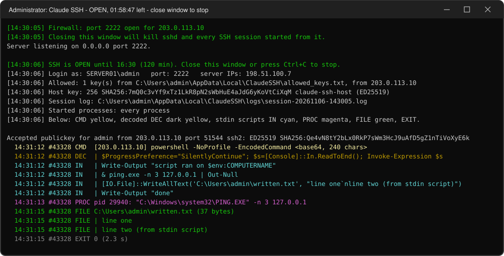

# Claude SSH: временный SSH-доступ к Windows-серверу под вашим присмотром

[English version](README.md)

**Что это.** ИИ-агент вроде Claude Code (или коллега) работает на вашем Windows-сервере по SSH. Доступ открыт на два часа, только по его ключу и только с его IP. Каждая команда, каждый скрипт и каждая запущенная программа видны в окне у вас на экране. Закрыли окно — пропали доступ, сессии и всё, что в них запустили.

Запустили `claude-ssh.bat` — SSH работает. Закрыли окно, нажали Ctrl+C или вышло время — SSH остановлен вместе со всеми сессиями и запущенными командами.
Ничего не устанавливается: ни служб, ни компонентов Windows. Внутри переносной OpenSSH 10.0p2 от Microsoft (файлы подписаны Microsoft). Системный sshd на порту 22, если он есть, не затрагивается.

> **Статус:** молодой инструмент (v0.2). Проверен на Windows 11 через loopback, без прав администратора. На Windows Server, с правилом фаервола и по реальной сети ещё не проверялся. Сначала попробуйте на тестовом сервере.

## Запуск

1. **На рабочей машине агента** один раз создайте ключ:
   ```bash
   ssh-keygen -t ed25519 -f "$HOME/.ssh/claude-access_ed25519" -C claude-access
   ```
   Понадобится публичная половина `claude-access_ed25519.pub` и адрес, с которого сервер увидит эту машину: внешний IP при доступе через интернет или адрес в локальной сети/VPN.
2. **На сервере** скачайте последнюю версию и распакуйте к себе в профиль. В PowerShell:
   ```powershell
   [Net.ServicePointManager]::SecurityProtocol = [Net.ServicePointManager]::SecurityProtocol -bor [Net.SecurityProtocolType]::Tls12
   $ProgressPreference = 'SilentlyContinue'
   $d = [Environment]::GetFolderPath('Desktop')
   Invoke-WebRequest https://github.com/lotgon/agentSSH/releases/latest/download/claude-ssh.zip -OutFile "$d\claude-ssh.zip" -UseBasicParsing
   Expand-Archive "$d\claude-ssh.zip" $d -Force
   & "$d\claude-ssh\claude-ssh.bat"
   ```
   Можно скачать [`claude-ssh.zip`](https://github.com/lotgon/agentSSH/releases/latest/download/claude-ssh.zip) и браузером. Тогда перед распаковкой откройте свойства файла и поставьте галочку «Разблокировать».

   Не кладите папку в общие места вроде `C:\` или `C:\Tools`. Окно работает с правами администратора, и кто может менять файлы инструмента, тот может выполнить свой код с этими правами. Если папку могут менять другие, окно предупредит красным.
3. Первый запуск создаст папку `%LOCALAPPDATA%\ClaudeSSH`, положит в неё `claude-ssh.config` и `allowed_keys.txt`, откроет её и попросит заполнить:
   - `allowed_keys.txt` — публичный ключ из шага 1;
   - `claude-ssh.config` — уберите `#` перед `AllowIp` и впишите адрес рабочей машины.
4. Запустите `claude-ssh.bat` ещё раз. Он попросит права администратора (UAC и Duo, если включён) — они нужны для правила фаервола.
5. В окне будет строка `SSH is OPEN until HH:MM`, имя для входа (`Login as:`) и отпечаток ключа сервера (`Host key`). Сообщите их агенту, например:
   ```text
   Подключись по SSH к моему Windows-серверу: хост 198.51.100.7, порт 2222, пользователь admin,
   ключ ~/.ssh/claude-access_ed25519. Отпечаток ключа сервера:
   SHA256:7mQ0c3vYf9xTz1LkR8pN2sWbHuE4aJdG6yKoVtCiXqM. Если он другой, не подключайся.
   Команды выполняются в cmd.exe; для PowerShell используй powershell -NoProfile -Command "...".
   Доступ закроется в 16:30.
   ```
   Имя пользователя — часть `Login as:` после обратной косой черты (`admin`). Проверено с локальной учёткой; доменные учётки ещё не проверялись.

Другая длительность: `claude-ssh.bat -Duration 4h` (также `90m`, `1h30m`, максимум `12h`).

**Обновление с v0.1.** Распакуйте новую версию поверх старой папки и запустите. Если рядом со скриптом остались `allowed_keys.txt`, `claude-ssh.config`, `hostkey\` или `last-session-commands-*.log`, первый запуск перенесёт их в `%LOCALAPPDATA%\ClaudeSSH`. Ключ сервера переносится вместе с ними, поэтому отпечаток не меняется и агенту не нужно заново подтверждать хост. Чтобы после этого вернуться на v0.1, верните эти файлы к скрипту, иначе v0.1 создаст новый ключ сервера с другим отпечатком.

## Кому подходит, а кому нет

**Подходит**, если вы администрируете сервер и хотите на время пустить агента или коллегу сделать задачу в консоли, пока вы смотрите: установить, настроить, разобраться с проблемой, перенести.

**Не подходит**, если:
- нужен **постоянный** доступ — установите компонент OpenSSH Server, RDP или PowerShell Remoting;
- нужно **одобрять каждую команду** заранее. Claude SSH команды *показывает*, но не спрашивает: команда выполняется сразу. Не нравится то, что видите, — закройте окно;
- входить должны **разные пользователи**: sshd работает от вашей учётки и пускает только под ней;
- у сервера никого не будет: окно нужно запускать и подтверждать UAC каждый раз.

## Где что лежит и у кого доступ

| Что | Где | Доступ |
|---|---|---|
| Скрипты и OpenSSH | папка, куда вы распаковали | у всех, кто может писать в эту папку, поэтому только в профиле |
| `claude-ssh.config`, `allowed_keys.txt` | `%LOCALAPPDATA%\ClaudeSSH` | вы, SYSTEM, Администраторы |
| Ключ сервера | `%LOCALAPPDATA%\ClaudeSSH\hostkey` | вы, SYSTEM, Администраторы (так требует sshd) |
| Логи сессий | `%LOCALAPPDATA%\ClaudeSSH\logs` | вы, SYSTEM, Администраторы |
| `authorized_keys`, `sshd_config` текущей сессии | `%LOCALAPPDATA%\ClaudeSSH\session` | создаются при запуске, удаляются при закрытии |
| Приватный ключ агента | только на рабочей машине агента | на сервер не попадает |

У папки `%LOCALAPPDATA%\ClaudeSSH` скрипт при каждом запуске отключает наследование прав и оставляет доступ только вам, SYSTEM и группе Администраторы.

Ни в git, ни в архив релиза из этого ничего не попадает: там только примеры `claude-ssh.config.example` и `allowed_keys.example.txt`. Другую папку данных можно задать параметром `-DataDir`.

## Что видно в окне



- Подключения, вход и отказы — сообщения самого `sshd`.
- Всё, что делает агент, — строками вида `время #номер ТЕГ текст`. Номер у каждой команды свой, по нему видно, что к чему относится, когда команды идут параллельно.

| Тег | Цвет | Что показывает |
|---|---|---|
| `CMD` | жёлтый | команда и IP, с которого она пришла |
| `DEC` | тёмно-жёлтый | расшифрованный `powershell -EncodedCommand` |
| `IN` | голубой | текст, переданный на stdin, — сами скрипты, которые выполняются через `[Console]::In.ReadToEnd()` |
| `PROC` | лиловый | каждый процесс, запущенный командой, с полной командной строкой (отступ — вложенность) |
| `FILE` | зелёный | файлы, записанные командой (`WriteAllBytes`, `WriteAllText`, `WriteAllLines`, `Set-Content`, `Out-File`), и их содержимое; файлы, залитые кусками base64, показываются уже расшифрованными |
| `EXIT` | серый, красный при ошибке | код выхода и время работы |
| `NOTE` | серый | прочее, например интерактивная сессия (`ssh -t`) |

В окне длинные блоки обрезаются до 40 строк, строки — до 400 символов, а длинный base64 сворачивается в `<base64, N chars>`. В логе всё целиком (до 1 МБ stdin на команду и до 256 КБ на записанный файл): `%LOCALAPPDATA%\ClaudeSSH\logs\session-<дата>.log`. Лог пишется по ходу сессии, поэтому сохранится, даже если окно убить.

Процессы: в окне с правами администратора видны все. Без прав администратора (`-NoFirewall`) список опрашивается раз в секунду, и процессы, которые живут меньше секунды, могут не попасть.

Логи содержат всё, что агент записал в файлы, включая пароли из конфигов. Папка закрыта для других пользователей, но, пересылая лог, помните об этом.

## Настройки

**`claude-ssh.config`** — откуда, какой порт и на сколько:
```ini
# Адреса, с которых можно подключаться: по одному на строку или через запятую; подсети тоже (10.8.0.0/24)
AllowIp = 203.0.113.10
AllowIp = 198.51.100.20
# Длительность по умолчанию: 2h, 90m, 1h30m; максимум 12h
Duration = 2h
# Не 22, чтобы не мешать системному sshd
Port = 2222
```

**`allowed_keys.txt`** — кто: публичные ключи, по одному на строку (обычно только ключ рабочей машины агента).

**Параметры** `claude-ssh.bat` действуют на один запуск и важнее настроек из файла:

| Параметр | По умолчанию | Что делает |
|---|---|---|
| `-Duration 4h` | `Duration` из файла, иначе `2h` | длительность: `90m`, `1h30m`, `3` (часа); от 1 минуты до 12 часов |
| `-Port 2200` | `Port` из файла, иначе `2222` | TCP-порт sshd |
| `-AllowIp 203.0.113.10,10.8.0.0/24` | `AllowIp` из файла | разрешённые адреса |
| `-ListenAddress 10.0.0.5` | `0.0.0.0` | адрес сервера, на котором слушает sshd |
| `-DataDir D:\ClaudeSSH` | `%LOCALAPPDATA%\ClaudeSSH` | где лежат настройки, ключи и логи |
| `-NoFirewall` | выключен | без правила фаервола и без запроса прав администратора; процессы опрашиваются раз в секунду |

## Защита

1. **Ключ — главный замок.** Паролей у этого sshd нет совсем, предлагается только вход по ключу. Приватный ключ лежит только на рабочей машине.
2. **IP — второй замок, сработает дважды:** правило фаервола пускает только адреса из `AllowIp`, а каждый ключ получает ограничение `from="..."` — sshd отклонит ключ с любого другого адреса.
3. **Время — третий замок.** Окно закрывается само. Ключ получает `expiry-time` и после срока не подходит, даже если что-то пошло не так.
4. sshd работает **от вашей учётки**, поэтому войти можно только под ней. Проброс портов, agent и X11 forwarding запрещены. Стандартный порт 22 и системный sshd, если он есть, не затрагиваются.
5. Всё, что запущено из окна, привязано к объекту-заданию Windows (Job Object). Когда окно закрывается или процесс убит, Windows сама убивает `sshd`, сессии и команды.
6. Ключи, настройки и логи лежат в папке, закрытой для других пользователей. Если папку с самим инструментом могут менять другие, окно предупреждает об этом.

**Что вы даёте:** команды выполняются от вашей учётки с правами окна. Окно запущено с правами администратора, так что считайте, что у агента ваши права администратора, пока окно открыто.

## Ограничения

- Окно **показывает, но не спрашивает**: команды выполняются сразу. Чтобы остановить, закройте окно.
- Ввод с клавиатуры в интерактивной сессии (`ssh -t`) не записывается, запущенные в ней программы видны.
- `FILE` ловит только файлы, записанные перечисленными выше способами с путём в кавычках. Файлы, изменённые иначе (`Copy-Item`, `robocopy`, другие программы), видны только как команда или процесс, который их изменил.
- `scp` и `sftp` не проверялись и, скорее всего, не работают: каждая сессия идёт через журнал команд. Агент может передавать файлы командами (например, base64 и `WriteAllBytes`), окно покажет файл уже расшифрованным.
- Если окно закрыли крестиком, правило фаервола `Claude-SSH-session` может остаться. Это безопасно: порт никто не слушает. При следующем запуске оно удаляется.
- Нужна Windows с Windows PowerShell 5.1 (есть в Windows 10 и Windows Server 2016 и новее). Пока проверено только на Windows 11.

## Проверено (локально, loopback)

- Вход по ключу работает; чужой ключ, чужой пользователь и вход без ключа — отказ.
- Адрес не из `AllowIp` получает отказ («Refused by key options»).
- Работают кавычки, `&` и `|`, коды выхода и stdin.
- Закрытие окна, Ctrl+C, истечение времени и жёсткое убийство скрипта завершают `sshd`, открытые сессии и запущенные в них команды.
- v0.2, без прав администратора: перенос старых файлов с тем же отпечатком ключа сервера; `CMD`, `DEC`, полный текст скрипта из stdin (300 строк), `PROC` для процесса, запущенного скриптом, `FILE` для `WriteAllText` и для заливки кусками base64; коды выхода; три параллельные команды без перемешивания строк; бинарные данные на stdin; сессия `ssh -tt`; создание шаблонов при первом запуске; предупреждение о папке, доступной на запись другим.

**Не проверено:** Windows Server, правило фаервола, доступность порта 2222 с другой машины и полный список процессов (`Win32_ProcessStartTrace`), для которых нужны права администратора или реальная сеть.
